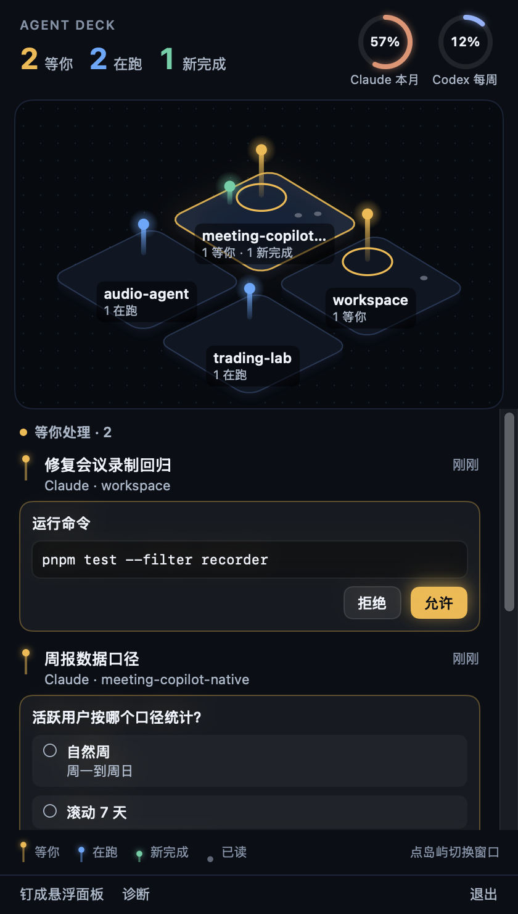
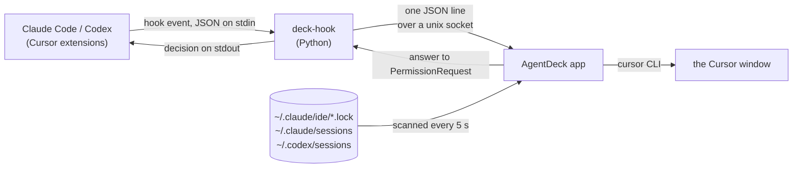

# agent-deck

[English](#english) · [中文](#中文)

<p align="center"></p>

---

## English

**A macOS menu bar deck for Claude Code and Codex sessions running in Cursor.** It shows which session is waiting on you, lets you approve commands and answer multiple-choice questions without leaving the window you are in, and brings the right Cursor window to the front when you do need to go there. The conversation itself stays in the Cursor extension.

### Why

If you run many agent sessions across several Cursor windows, finding out who needs you means visiting every window and every tab, and an approval prompt can sit unnoticed in a window you are not looking at. agent-deck puts all of them in one place.

### What it does

- **A map of your Cursor windows.** Each open window is an island; its sessions stand on it as beacons: amber and tallest with a spreading ring = waiting on you, blue and bobbing = running, green = just finished, grey dot = read. The six busiest windows get islands; the rest are listed under the map. Click an island to see its sessions.
- **Answer in place.** Claude Code permission prompts show the full command or diff with Allow / Deny; `AskUserQuestion` choices can be picked (or a custom answer typed). Whatever is waiting on you stays pinned at the top, whichever island is selected. Cursor keeps showing its own prompt, and whoever answers first wins.
- **Reply to Codex.** When a Codex session finishes, you can send it the next message from the deck (`codex queue`).
- **Jump to the window.** "跳到这个窗口" or a click on a session raises the Cursor window it runs in, including multi-root workspaces (saved `.code-workspace` or untitled).
- **Usage at a glance.** Rings for your Claude and Codex limits; click them for reset times and a forecast of when you will run out.
- **Notifications** when a session needs you or finishes, and a **floating panel** that stays on top across Spaces.
- Follows the system's **Reduce Motion** setting. The UI text is in Chinese.

### How it works



- **Hooks.** `scripts/install.py` registers `deck-hook` for `SessionStart`, `UserPromptSubmit`, `PermissionRequest`, `PostToolUse` and `Stop` in Claude Code and Codex, plus `StopFailure` in Claude Code and `SessionEnd` in Codex. Each event goes to the app over `~/Library/Application Support/agent-deck/deck.sock` as one line: `{"v":1,"tool":"claude","event":"PermissionRequest","wait":true,"payload":{…}}`. Only `PermissionRequest` waits for a reply (`{"output": …}`), which the hook prints as its decision. If the app is not running, the hook exits within about 0.1 s and the session carries on as if nothing were installed.
- **Cursor's own agent.** Cursor also runs the hooks in `~/.claude/settings.json` for its built-in agent (Settings → Third-Party Imports). deck-hook ignores those calls. Claude Code gets no `SessionEnd` hook because Cursor makes a closing window wait for it; the deck notices an ended Claude session on its next scan instead.
- **Discovery.** Open Cursor windows come from the Claude Code extension's lock files (`~/.claude/ide/*.lock`), live Claude sessions from `~/.claude/sessions`, Codex threads from `~/.codex/sessions`. Headless runs (`claude -p`, `codex exec`) are ignored.
- **Jumping.** The window is raised with the `cursor` command, pointed at the folder, the saved `.code-workspace`, or for an untitled multi-root workspace the `workspace.json` Cursor keeps for it.
- **Usage.** Claude: the Claude Code binary that ships inside the Cursor extension answers a `get_usage` control request (the same data as the extension's usage panel). Codex: `rate_limits` from local rollout files. agent-deck itself makes no network requests.

### Requirements

- macOS 14 or later
- Xcode Command Line Tools (Swift 6; Xcode itself is not needed) and `/usr/bin/python3`
- Cursor with the Claude Code extension; the Codex extension is optional

### Install

```sh
git clone https://github.com/Mrright36988/agent-deck.git
cd agent-deck
./scripts/build_app.sh                         # builds build/AgentDeck.app with SwiftPM
open build/AgentDeck.app                       # menu bar icon; allow notifications when asked
/usr/bin/python3 scripts/install.py install    # adds the hooks; backs up your settings first
```

- **Claude Code** picks the hooks up immediately.
- **Codex** runs only trusted hooks: in Cursor, open Codex settings → Hooks and trust each agent-deck entry.
- `install.py status` / `install.py doctor` show what is installed, which Codex hooks still need trust, and whether the app is reachable.
- `install.py uninstall` removes the hooks; if nothing else changed since install, your settings files are restored byte for byte.
- After updating agent-deck, run `install.py uninstall` and then `install.py install` so the hooks match the new version.
- Optional: `scripts/make_signing_identity.sh` creates a local code-signing identity so macOS permissions survive rebuilds (you trust its certificate once); without it the app is signed ad hoc.

### Safety

- Answers go through the official hook decision channel only. agent-deck never types into a session or fakes user input.
- The `agentdeck://diag/…` URLs used for development can raise windows and render images, but can never answer a prompt.
- Everything stays on your Mac.

### Limitations

- Jumping reaches the window, not the tab: pick the tab named in the deck yourself.
- Claude Code has no official channel for sending free text into an extension session, so typed replies to Claude still go through the extension's input box.
- Codex approvals are listed but answered in Cursor.
- Built and tested with Cursor on macOS only.

### Development

```
Sources/DeckCore/      pure logic, no AppKit: hook protocol and socket server, inbox state machine,
                       on-disk session formats, window/workspace resolution, isometric map layout, usage parsing
Sources/AgentDeck/     the menu bar app: DeckStore (state and actions), UI/, Window/ (jumping),
                       Discovery/, Notify/, Codex/, Usage/, Diagnostics/
Tests/DeckCoreTests/   Swift tests for DeckCore
hook/                  deck_hook.py, the command Claude Code and Codex run, with its tests
scripts/               install.py (hooks), build_app.sh, make_signing_identity.sh
docs/                  requirements and research notes (in Chinese), spike probes, images
```

```sh
swift test                                                    # DeckCore
/usr/bin/python3 -m unittest discover -s hook -p 'test_*.py'
/usr/bin/python3 -m unittest discover -s scripts -p 'test_*.py'
open -g "agentdeck://diag/demo?windows=8"   # renders made-up sessions to ~/Library/Application Support/agent-deck/demo-8.png
```

Other diagnostics: `diag/status`, `diag/dump` (inbox to the log), `diag/snapshot` (the live UI to a PNG), `diag/panel`, `diag/notify`.

### License

[MIT](LICENSE)

---

## 中文

**一个 macOS 菜单栏小工具，统一照看 Cursor 里的 Claude Code 和 Codex 会话。** 它告诉你哪个会话在等你；审批命令、回答选择题都不用离开当前窗口；真需要过去时，一键把对应的 Cursor 窗口切到前台。对话本身仍然留在 Cursor 插件里。

### 为什么做

同时在好几个 Cursor 窗口里跑很多个 agent 会话时，想知道谁在等你，只能挨个窗口、挨个 tab 去看；一个审批请求可能就停在你没在看的窗口里，迟迟没人处理。agent-deck 把它们集中到一处。

### 能做什么

- **Cursor 窗口地图**：每个打开的窗口是一座岛，会话是岛上的光柱。琥珀色、最高、带扩散光圈的是在等你；蓝色、上下浮动的是在跑；绿色是刚完成；灰点是已读。最忙的 6 个窗口画成岛，其余列在地图下方。点岛屿查看它的会话。
- **就地作答**：Claude Code 的权限请求会显示完整命令或 diff，可以直接允许或拒绝；`AskUserQuestion` 选择题可以直接选，也可以自己写答案。等你处理的卡片固定在最上面，和选中哪座岛无关。Cursor 里的提示照常显示，哪边先答算哪边的。
- **回复 Codex**：Codex 会话结束后，可以在 deck 里直接发下一条消息（`codex queue`）。
- **跳到窗口**：点“跳到这个窗口”或点会话，把它所在的 Cursor 窗口切到前台，支持多根 workspace（已保存的 `.code-workspace` 和未保存的都行）。
- **用量一眼可见**：Claude 和 Codex 的额度用圆环显示；点开能看重置时间，以及按当前速度预计何时用完。
- 会话等你或完成时发**系统通知**；可以**钉成悬浮面板**，在所有桌面空间置顶显示。
- 跟随系统的**减弱动态效果**设置。界面文字是中文。

### 工作原理

（流程图见上方英文部分）

- **Hook**：`scripts/install.py` 在 Claude Code 和 Codex 里为 `SessionStart`、`UserPromptSubmit`、`PermissionRequest`、`PostToolUse`、`Stop` 注册 `deck-hook`，Claude Code 另加 `StopFailure`，Codex 另加 `SessionEnd`。每个事件通过 `~/Library/Application Support/agent-deck/deck.sock` 以一行 JSON 发给 app：`{"v":1,"tool":"claude","event":"PermissionRequest","wait":true,"payload":{…}}`。只有 `PermissionRequest` 会等待回复（`{"output": …}`），hook 把它作为决定输出。app 没在运行时，hook 约 0.1 秒内退出，会话照常进行，就像没装过一样。
- **Cursor 自带的 Agent**：Cursor 也会拿 `~/.claude/settings.json` 里的 hook 去跑它自带的 Agent（设置 → Third-Party Imports），deck-hook 会忽略这些调用。Claude Code 不注册 `SessionEnd`，因为 Cursor 关窗时要等它跑完；Claude 会话结束改由 deck 下一次扫描发现。
- **发现会话**：打开的 Cursor 窗口来自 Claude Code 插件的锁文件（`~/.claude/ide/*.lock`），存活的 Claude 会话来自 `~/.claude/sessions`，Codex 会话来自 `~/.codex/sessions`。无头运行（`claude -p`、`codex exec`）会被忽略。
- **跳转**：用 `cursor` 命令拉起窗口，参数是目录、已保存的 `.code-workspace`，或者未保存的多根 workspace 在 Cursor 里对应的 `workspace.json`。
- **用量**：Claude 部分由 Cursor 插件自带的 Claude Code 程序响应 `get_usage` 控制请求，数据和插件的用量面板同源；Codex 部分读本地 rollout 文件里的 `rate_limits`。agent-deck 本身不发任何网络请求。

### 环境要求

- macOS 14 及以上
- Xcode Command Line Tools（Swift 6，不需要装 Xcode）和 `/usr/bin/python3`
- Cursor，并装好 Claude Code 插件；Codex 插件可选

### 安装

```sh
git clone https://github.com/Mrright36988/agent-deck.git
cd agent-deck
./scripts/build_app.sh                         # 用 SwiftPM 构建 build/AgentDeck.app
open build/AgentDeck.app                       # 出现菜单栏图标；系统询问时允许通知
/usr/bin/python3 scripts/install.py install    # 安装 hook，先备份原有配置
```

- **Claude Code**：装完立即生效。
- **Codex**：只执行受信任的 hook。在 Cursor 里打开 Codex 设置 → Hooks，逐条信任 agent-deck 的条目。
- `install.py status` / `install.py doctor`：查看装了什么、哪些 Codex hook 还没信任、app 能否连通。
- `install.py uninstall`：移除 hook；如果安装后配置没有别的改动，会逐字节还原原文件。
- 更新 agent-deck 后，先跑 `install.py uninstall` 再跑 `install.py install`，让 hook 和新版本一致。
- 可选：`scripts/make_signing_identity.sh` 生成本地签名证书，重新构建后系统权限不会失效（需要你手动信任一次证书）；不生成的话用临时签名。

### 安全

- 只通过官方的 hook 决定通道作答，从不往会话里打字，也不伪造用户输入。
- 开发用的 `agentdeck://diag/…` 链接能拉起窗口、渲染图片，但不能回答任何请求。
- 所有数据都留在本机。

### 已知限制

- 跳转只能到窗口，不能自动切到 tab：按 deck 上写的会话名自己点一下。
- Claude Code 没有向插件会话发送文字的官方通道，给 Claude 打字回复仍要在插件输入框里完成。
- Codex 的审批会列出来，但要在 Cursor 里处理。
- 只在 macOS 上的 Cursor 中构建和测试过。

### 开发

目录结构、测试命令和诊断链接见上方英文部分。`docs/` 里是需求文档和验证记录（中文）。

### 许可证

[MIT](LICENSE)
